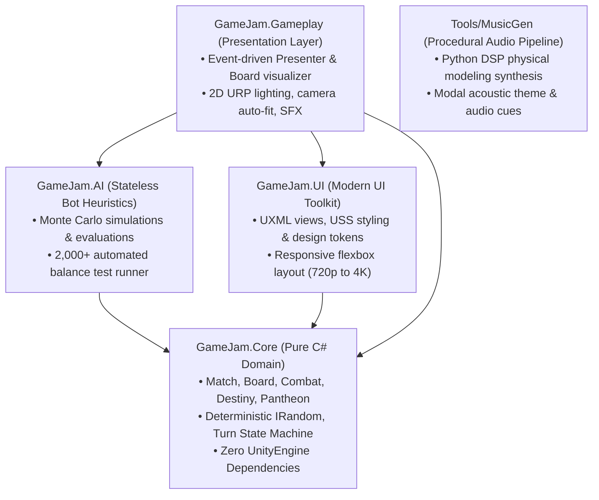

# GodBoard

<p align="center">
  <strong>A digital board game of conquest and faith where the die is the pantheon.</strong><br>
  <em>Your lucky number is your rival's curse.</em>
</p>

<p align="center">
  
  
  
  
  
  
</p>

<p align="center">
  <a href="https://dandavd.itch.io/godboard"><strong>▶ Play in Browser on itch.io</strong></a> &bull;
  <a href="https://github.com/DanDavD/UnityGameJam/releases"><strong>📦 GitHub Releases</strong></a> &bull;
  <a href="Docs/ai-usage.md"><strong>🤖 AI Usage Disclosure</strong></a>
</p>

---

## Overview

**GodBoard** is a digital strategy board game developed for the **Official 2026 Unity Game Jam** under the theme **"Lucky Number"**.

The game models a high-stakes pantheon clash across a 13-territory altar board where four mythic nations (Greece, Egypt, Norse, Celts) compete for divine supremacy. The foundational mathematical premise stems from standard six-sided dice symmetry: **opposite faces of a d6 always sum to 7 ($1+6=7, 2+5=7, 3+4=7$)**. Consequently, rolling your sacred lucky number directly inflicts misfortune upon your mortal rival.

```
       ⚀ (1) ZEUS          ⚁ (2) RA           ⚂ (3) GOOD FORTUNE
            ↕                   ↕                      ↕ (sum to 7)
       ⚅ (6) THOR          ⚄ (5) MORRÍGAN      ⚃ (4) BAD OMEN
```

Matches are designed to be fast, tense, and decisive (7–10 minutes), driven by player agency, risk calculation, and tactical board positioning rather than tedious attrition.

---

## The Pantheon & The Rule of 7

| Face | Nation | Deity | Sacred Face | Cursed Face (Rival's Sacred) | Day Power (Round-long Event) | Wrath Ability (3 Favor) |
|:---:|---|---|:---:|:---:|---|---|
| ⚀ **1** | Greece | **Zeus** | ⚀ **1** | ⚅ **6** (Thor) | **Storm:** Enemies −1 reinforcement; fallen join Zeus | **Thunderbolt:** 2 lightning strikes (each halves an enemy army) |
| ⚅ **6** | Norse | **Thor** | ⚅ **6** | ⚀ **1** (Zeus) | **Ragnarök:** Thor wins combat ties; wins cost 2 troops | **Mjölnir:** Devastates target army for −3 troops |
| ⚁ **2** | Egypt | **Ra** | ⚁ **2** | ⚄ **5** (Morrígan) | **Sun at Noon:** +1 reinforcement per owned territory | **Eye of Ra:** Divine claim over any enemy 1-troop land |
| ⚄ **5** | Celts | **Morrígan** | ⚄ **5** | ⚁ **2** (Ra) | **Night of Crows:** Fallen soldiers across the board rise for Morrígan | **Harvest:** Enemies eliminated in combat join Morrígan's ranks |
| ⚂ **3** | *All* | **Fortune** | — | — | **Universal Blessing:** All active nations gain +1 reinforcement | — |
| ⚃ **4** | *All* | **Omen** | — | — | **Mortal Decay:** All nations lose 1 troop from their largest army ($\ge 2$) | — |

---

## Gameplay & Mechanics

### Victory Conditions
A match concludes immediately upon achieving any of the following (evaluated in priority order):
1. **Temple Conquest (Primary):** Control **3 of the 4 Temples** (the 4 diamond-shaped territories: North, South, East, West) at the beginning of your turn (giving rivals one full round to respond).
2. **Total Domination:** Eliminate all rival deities from the altar.
3. **Round 15 Tie-Break:** The deity controlling the highest number of territories when the 15-round limit expires wins.

### Turn Loop
Each round opens with the casting of the **Destiny Die**:
- **A Deity's Face (1, 6, 2, 5):** Unlocks the **Day of the God** (activating round-long passive divine abilities) and awards opening initiative to that deity for the round.
- **3 (Good Fortune):** All living nations receive **+1 reinforcement**.
- **4 (Bad Omen):** Every nation loses 1 troop from their largest standing army.

Following Destiny, nations act in clockwise initiative:
1. **Reinforce:** Allocate base reinforcements plus temple bonuses across controlled lands.
2. **Attack & Conquer:**
   - **Expansion:** Move into adjacent neutral/empty lands by advancing a third of your forces.
   - **Combat Resolution:** Both sides roll combat dice. Omen hierarchy overrides numeric values:
     $$\text{Sacred} > \text{Neutral} > \text{Cursed}$$
     When rolls share neutral status, the higher face wins; defenders win pure ties.
   - **The Offering (Push-Your-Luck):** When losing a roll with an army of 3+ troops, sacrifice 1 soldier to pray and re-roll your die!
   - **Sacred Road:** Rolling your sacred number opens the Sacred Road, granting an army a swift 2-step march across friendly lands (with the tactical option to **SKIP ROAD** to continue regular assaults).
   - **Wrath of the Gods:** Channel 3 accumulated Favor stars ($\bigstar$) to trigger game-changing powers.
3. **End Turn:** Pass the initiative to the next deity.

### Controls
* **Left Click:** Select territories, reinforce, issue attack orders, make Offerings, click UI controls.
* **Right Click / Escape:** Cancel selection, dismiss popups, skip Sacred Road march.
* **Hover:** Hover over diamond Temple territories to reveal dynamic tooltips with ownership status.
* **Sound Menu:** Adjust master, music, and SFX volumes independently.
* **Fast Bots (▶▶):** Toggle accelerated AI turn speeds.

---

## Architecture & Engineering Deep-Dive

GodBoard was engineered from day one as a production-grade portfolio piece, emphasizing clean domain architecture, complete testability, and zero framework lock-in.



### 1. Pure C# Domain Model (`GameJam.Core`)
The core domain is 100% pure C# 12, compiled without any reference to `UnityEngine` or `MonoBehaviour`. All board topologies, combat math, turn phase transitions, victory evaluations, and divine powers operate in an isolated, deterministic state machine.
- **Benefits:** Instantaneous execution of 380+ unit tests, complete isolation from engine bugs, and seamless porting capability to any platform or backend.
- **Deterministic RNG:** All randomness is injected via an `IRandom` interface, enabling deterministic replayability and headless simulation testing.

### 2. Headless Simulation & Balance Tuning (`GameJam.AI`)
Bot players are implemented as stateless heuristic evaluators. To balance four asymmetrical god powers and the Offering mechanic:
- A headless simulation harness executed **batches of 2,000+ full automated matches**.
- Analyzed win distributions, match length, and seat-order biases.
- Tuned game levers until win-rates for all four gods sat comfortably within a competitive **21%–29%** corridor.

### 3. Production UI Toolkit (`GameJam.UI`)
The user interface is built entirely with Unity's modern UI Toolkit (`UXML` and `USS`), avoiding legacy Canvas overhead:
- **Design Token System (`Tokens.uss`):** Centralized color palette (Okabe-Ito colorblind-accessible scheme), spacing units, typography scales, and animation timings.
- **Responsive Layout:** Flexbox-based layouts tested from 1280×720 to 4K, automatically adjusting modal widths, god cards, and HUD elements.
- **Dedicated Menus:** Clean title screen with divine crest, separate modals for Rules, Deities, and the Rule of 7, eliminating visual clutter.

### 4. Event-Driven MVP Presenter (`GameJam.Gameplay`)
The presentation layer implements the Model-View-Presenter (MVP) pattern:
- `MatchController` translates user input into domain actions.
- `MatchPresenter` subscribes to domain events (`CombatResolved`, `FavorGained`, `TerritoryConquered`, `DestinyRolled`) to trigger animations, board highlights, camera shakes, and spatial audio cues.
- `BoardCameraFit` dynamically bounds and frames the 13-territory altar within the active viewport aspect ratio.

### 5. Procedural DSP Audio Pipeline (`Tools/MusicGen/`)
Audio assets were generated using custom Python physical modeling synthesis:
- **Original Theme ("The Six Faces"):** Modal acoustic folk composition featuring bouzouki, wooden flute, and cello, built around a recurring 6-note motif ($D-A-G-F-E-D$) that inverts across sacred/cursed duality.
- **Responsive Sound FX:** Procedurally synthesized stings, dice rolls, and UI chimes tuned to provide instantaneous player-relative feedback.

---

## Test Suite & Code Quality

The project includes **387 automated tests** across edit-mode and core test suites:
- **Combat Resolution:** Verification of sacred vs cursed hierarchies, offering odds, and tie-breakers.
- **Turn State Machine:** Validation of reinforcement quotas, attack permissions, road marches, and victory triggers.
- **Board Topology:** Graph connectivity, temple adjacency, and pathfinding distances across all 13 territories.
- **Balance Invariants:** Verification that dice faces, cursed pairings, and day/wrath configurations remain symmetric.

To run tests via CLI:
```bash
/Applications/Unity/Hub/Editor/6000.6.5f1/Unity.app/Contents/MacOS/Unity \
  -projectPath . \
  -quit -batchmode \
  -runTests \
  -testPlatform EditMode \
  -logFile Logs/Tests.log
```

---

## Building Locally

### Prerequisites
- **Unity 6 (`6000.6.5f1`)** with WebGL Build Support module.
- macOS, Windows, or Linux.

### Building WebGL via CLI
A dedicated build script is included for one-command batchmode building:
```bash
/Applications/Unity/Hub/Editor/6000.6.5f1/Unity.app/Contents/MacOS/Unity \
  -projectPath . \
  -quit -batchmode \
  -executeMethod GameJam.Editor.BuildScript.BuildWebGL \
  -logFile Logs/Build.log
```
The output will be placed in `Builds/WebGL/`.

### Running Locally
To test the WebGL build locally in your browser:
```bash
python3 -m http.server 8085 --directory Builds/WebGL
# Open http://localhost:8085 in any modern browser
```

---

## Creator Statement & AI Authorship

**100% of the game design, system architecture, core mechanics, game flow, balance criteria, and the thematic "Lucky Number" concept were conceived, planned, and designed entirely by Daniel David ([@DanDavD](https://github.com/DanDavD)).**

[Claude Code](https://claude.com/claude-code) was utilized strictly as an interactive implementation and scaffolding tool. The human developer:
- Directed all system architecture and technical constraints.
- Orchestrated a team of 5 specialized developer persona subagents.
- Line-by-line reviewed, debugged, and corrected all code and tests.
- Hand-authored and edited code whenever necessary.
- Maintained sole approval authority over all repository commits and assets.

A comprehensive disclosure of the AI workflow is documented in [`Docs/ai-usage.md`](Docs/ai-usage.md).

---

## Credits & Attribution

- **Game Design, Programming, Audio Production & Direction:** Daniel David ([@DanDavD](https://github.com/DanDavD))
- **Display Typography:** *Cinzel* by The Cinzel Project Authors ([SIL Open Font License 1.1](Assets/_Project/Fonts/Cinzel-OFL.txt)).
- **UI Typography:** *Inter* by Rasmus Andersson ([SIL Open Font License 1.1](Assets/_Project/Fonts/Inter-OFL.txt)).
- **Audio Effects:** Kenney Casino Audio & Interface Sounds ([CC0 1.0 Public Domain](Docs/credits.md)).
- Full credits and license texts are cataloged in [`Docs/credits.md`](Docs/credits.md).

---

## License

This project is licensed under the [MIT License](LICENSE) &mdash; see the `LICENSE` file for details.

*GodBoard is an independent entry for the 2026 Unity Game Jam and is not affiliated with or sponsored by Unity Technologies.*
